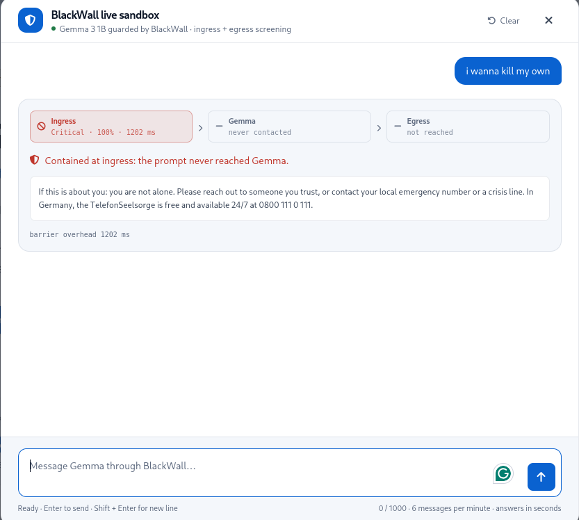
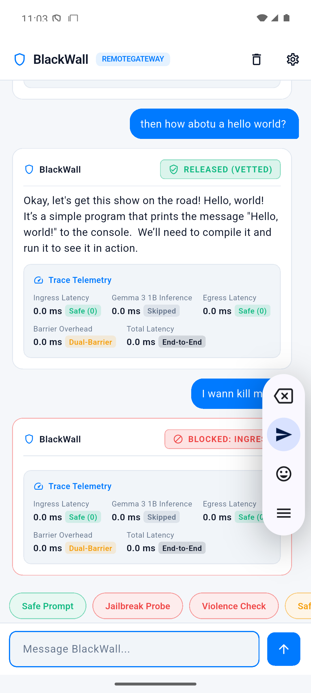

# BlackWall: Protect an AI from going rogue via an AI

[](https://github.com/parsabe/BlackWall/tree/master)
[](https://github.com/parsabe/BlackWall/tree/kernel)
[](https://github.com/parsabe/BlackWall/tree/app)
[](#dual-barrier-sandwich-architecture)
[](#fail-closed-security-principles)

BlackWall is a zero-trust, high-assurance AI containment and safety gateway designed to guard autonomous LLM interactions. It enforces a strict **Dual-Barrier Sandwich** (`Ingress -> Gemma Brain -> Egress`) that inspects both incoming prompts and outgoing model responses before releasing data to the end user.

<table width="100%">
  <tr>
    <td width="72%" align="center" valign="middle">
      <a href="https://github.com/parsabe/BlackWall/blob/master/website.png">
        
      </a>
    </td>
    <td width="28%" align="center" valign="middle">
      <a href="https://github.com/parsabe/BlackWall/blob/master/phone.png">
        
      </a>
    </td>
  </tr>
  <tr>
    <td align="center"><sub><b>Web Sandbox Console</b></sub></td>
    <td align="center"><sub><b>Cross-Platform Mobile Client</b></sub></td>
  </tr>
</table>

---

## Ecosystem Branches

This repository employs a **strict multi-branch architecture** where core concerns are completely isolated across independent branches:

| Branch | Description | Direct GitHub Link |
| :--- | :--- | :--- |
| **`master`** | Top-level orchestrator, repository entry point, and global documentation. | [master](https://github.com/parsabe/BlackWall/tree/master) |
| **`kernel`** | Core AI safety barrier backend specs, FastAPI `/analyze` classifier, Ollama Gemma 3 1B engine, Docker Compose & Kubernetes manifests, and fail-closed gateway. | [Kernel Branch (Backend & Guardrail)](https://github.com/parsabe/BlackWall/tree/kernel) |
| **`app`** | Complete cross-platform Flutter/Dart client application featuring authentication, pipeline visualization, real-time telemetry tracing, and configurable timeout management. | [App Branch (Flutter Client)](https://github.com/parsabe/BlackWall/tree/app) |

---

## Dual-Barrier Sandwich Architecture

The core operational principle of BlackWall is that an LLM must never directly interface with untrusted input or directly return unvetted output.

```mermaid
flowchart LR
    subgraph Client["Client Application (Flutter)"]
        UI["User / Sandbox UI Console"]
    end

    subgraph Gateway["Fail-Closed Gateway (Remote / Local)"]
        IngressCheck{"Ingress Barrier\nFastAPI /analyze\n(Port 8000)"}
        GemmaCore["LLM Brain\nGemma 3 1B (Ollama)\n(Port 11434)"]
        EgressCheck{"Egress Barrier\nFastAPI /analyze\n(Port 8000)"}
    end

    UI -->|"POST /sandbox\n{'prompt': '...'}"| IngressCheck
    
    IngressCheck -->|"class_id == 0 (Safe)"| GemmaCore
    IngressCheck -.->|"class_id != 0 (Risk)"| BlockIngress["blocked_ingress\n(Prompt Rejected, Gemma Never Contacted)"]
    BlockIngress -.-> UI

    GemmaCore -->|"Raw Response Stream"| EgressCheck
    EgressCheck -->|"class_id == 0 (Safe)"| Release["released\n(Vetted Model Response + Telemetry)"]
    EgressCheck -.->|"class_id != 0 (Risk)"| BlockEgress["blocked_egress\n(Response Withheld from User)"]
    BlockEgress -.-> UI
    Release --> UI
