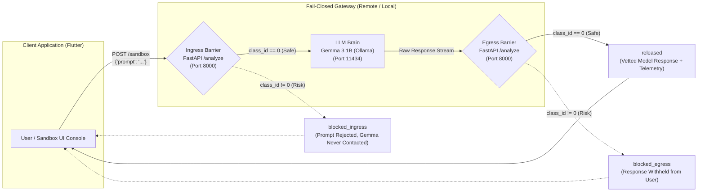

# BlackWall: Protect an AI from going rogue via an AI


[](https://github.com/parsabe/BlackWall/tree/master)
[](https://github.com/parsabe/BlackWall/tree/kernel)
[](https://github.com/parsabe/BlackWall/tree/app)
[](#dual-barrier-sandwich-architecture)
[](#fail-closed-security-principles)

BlackWall is a zero-trust, high-assurance AI containment and safety gateway designed to guard autonomous LLM interactions. It enforces a strict **Dual-Barrier Sandwich** (`Ingress -> Gemma Brain -> Egress`) that inspects both incoming prompts and outgoing model responses before releasing data to the end user.

---

## Ecosystem Branches

This repository employs a **strict multi-branch architecture** where core concerns are completely isolated across independent branches:

| Branch | Description | Direct GitHub Link |
| :--- | :--- | :--- |
| **`master`** | Top-level orchestrator, repository entry point, and global documentation. | [master](https://github.com/parsabe/BlackWall/tree/master) |
| **`kernel`** | Core AI safety barrier backend specs, FastAPI `/analyze` classifier, Ollama Gemma 3 1B engine, Docker Compose & Kubernetes manifests, and fail-closed gateway. | [Kernel Branch (Backend & Guardrail)](https://github.com/parsabe/BlackWall/tree/kernel) |
| **`app`** | Complete cross-platform Flutter/Dart client application featuring authentication, pipeline visualization, real-time telemetry tracing, and configurable timeout management. | [App Branch (Flutter Client)](https://github.com/parsabe/BlackWall/tree/app) |

---

## Dual-Barrier Sandwich Architecture

The core operational principle of BlackWall is that an LLM must never directly interface with untrusted input or directly return unvetted output.



### Classification Severity Taxonomy

The BlackWall classifier evaluates safety according to a 3-tier severity matrix:

| Class ID | Designation | Definition | Action Taken |
| :---: | :---: | :--- | :--- |
| **`0`** | **Safe** | Input or output passes all compliance, semantic, and safety checks. | Permitted to advance to next stage. |
| **`1`** | **General Risk** | Content exhibits policy violations, hate speech, violence, or unauthorized guidance. | Blocked at ingress or suppressed at egress. |
| **`2`** | **Critical Risk** | Injection attack, jailbreak attempt, prompt leakage, hostile payload, or dangerous instruction. | Blocked immediately; audit log triggered. |

---

## Fail-Closed Security Principles

1. **Zero Raw Passthrough**: All communication routes through the barrier pipeline.
2. **Deterministic Fallback**: If either the classifier (Port 8000) or the LLM engine (Port 11434) is unresponsive or throws an unexpected exception, the system fails closed with `status: "offline"`.
3. **No Unvetted Egress**: Gemma 3 1B responses are never streamed directly to the user without passing the egress barrier check.
4. **Latency Telemetry**: Every transaction tracks:
   - Ingress barrier check latency (`ms`)
   - Gemma 3 1B model inference time (`ms`)
   - Egress barrier check latency (`ms`)
   - Total barrier overhead (`ms`)

---

## Gateway Endpoints

| Service | Protocol / Port | Endpoint | Description |
| :--- | :--- | :--- | :--- |
| **Remote Gateway** | HTTPS | `POST https://parsabe.com/projects/blackwall/sandbox` | Production public gateway (`{"prompt": "..."}`) |
| **Local Gateway** | HTTP:8080 | `POST http://127.0.0.1:8080/sandbox` | Local orchestration gateway |
| **Classifier Barrier** | HTTP:8000 | `POST http://127.0.0.1:8000/analyze` | Evaluates safety (`class_id: 0, 1, 2`) |
| **LLM Brain** | HTTP:11434 | `POST http://127.0.0.1:11434/api/chat` | Ollama hosting Gemma 3 1B |

---

## Branch Checkout & Worktree Management

Because branches maintain separate histories, use dedicated branch clones or git worktrees.

### Method A: Clone Specific Branches
```bash
# Clone the Kernel branch (Backend & Guardrail)
git clone --branch kernel git@github.com:parsabe/BlackWall.git BlackWall-kernel

# Clone the App branch (Flutter Client)
git clone --branch app git@github.com:parsabe/BlackWall.git BlackWall-app
```

### Method B: Manage via Git Worktree
```bash
# Clone master repository
git clone git@github.com:parsabe/BlackWall.git BlackWall
cd BlackWall

# Mount kernel branch into a sibling directory
git worktree add ../BlackWall-kernel kernel

# Mount app branch into a sibling directory
git worktree add ../BlackWall-app app
```

---

## Hardware & Performance Considerations

- **CPU Host Inference**: When running Gemma 3 1B on CPU instances without AVX-512 or GPU acceleration, end-to-end response times under high prompt token loads can take **60s to 100s**.
- **Client Timeouts**: The client application implements an adjustable timeout threshold (10s – 120s, default 90s) to accommodate deep reasoning and CPU execution bounds without connection aborts.

---

## License

BlackWall is released under the [Apache 2.0 License](LICENSE).
